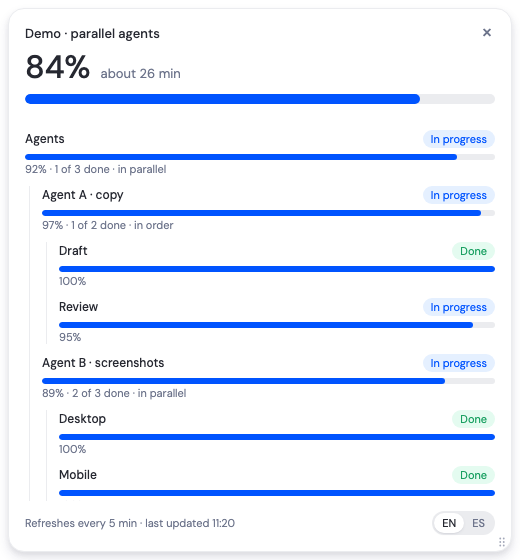

# A ver a qué horas · progress widget for Claude Code

A small floating window that shows how far along a long-running Claude Code job is: overall %, estimated time left, and one bar per step. It stays on top of every window and every desktop, and refreshes itself.

Built for the moments when you hand work to background agents (a review round, a migration, a batch of screenshots) and want to know at a glance how it's going without asking Claude every ten minutes.



## What you get

- **Floating widget**, top right by default. Drag it anywhere (any display); it remembers where you left it. × (or Esc) closes it.
- **Resizable, with scroll.** It grows with its steps up to 520 px tall; past that the step list scrolls while the title, overall % and footer stay put. Drag the bottom-right corner to resize it (320–720 px wide); it remembers that size too.
- **Sequential, parallel or nested work.** Steps can run one after another, all at once, or in groups: parallel agents, each with its own sequential or parallel tasks, at any depth.
- **Browser page** with the same progress plus the latest commits of the branch, for a bigger view.
- **Title on top**, so you can tell several widgets apart.
- **EN / ES switch** at the bottom right. Your choice applies to every widget and page.
- **Auto refresh** every 5 minutes by default, with the time of the last update.

## Install

Requirements: macOS, Claude Code (CLI, desktop or Conductor), `python3`, Node/npm.

```bash
git clone https://github.com/MikeVillaIncode/averaquioras.git ~/.claude/skills/averaquioras
```

That's it. The first run installs Electron into `widget/node_modules` (about 200 MB, one time). To update later:

```bash
git -C ~/.claude/skills/averaquioras pull
```

## Use

While Claude is running something in the background, type:

```
/averaquioras
```

Claude picks 3 to 8 steps of the job, a signal for each one that proves it finished (a report file, a screenshot folder, a command), and an estimate in minutes. Then it opens the widget and gives you the page link.

You can also just ask: "show me a progress widget", "how much is left?".

### How progress is measured

Only things Claude can observe: a file that appears, files matching a pattern, a command that succeeds, git commits. A step's bar fills with time against its estimate and stops at 95 % until its done-signal shows up, so the estimate corrects itself as steps finish. **Time left is an estimate, not a promise.**

### Manual control

```bash
# reopen (or restart) a widget
~/.claude/skills/averaquioras/scripts/run.sh ~/.claude/averaquioras/<job>/config.json

# stop it
~/.claude/skills/averaquioras/scripts/stop.sh ~/.claude/averaquioras/<job>/config.json
```

Each job lives in `~/.claude/averaquioras/<job>/` (config, the rendered widget and page, logs).

### Config example

```json
{
  "title": {"en": "Review round 1 · PR branch", "es": "Ronda de revisión 1 · rama del PR"},
  "lang": "en",
  "start": 1793891925,
  "refreshSeconds": 300,
  "steps": [
    {"key": "layout", "title": {"en": "Layout and tables", "es": "Layout y tablas"}, "minutes": 75,
     "done": {"file": "/abs/path/.context/review1-layout.md"},
     "count": {"glob": "/abs/path/shots/layout/**/*.png", "label": {"en": "screenshots", "es": "capturas"}}}
  ],
  "commits": {"repo": "/abs/path/repo", "range": "origin/develop..my-branch"}
}
```

Any text can be a plain string or `{"en": ..., "es": ...}`. Done-signals: `{"file": ...}`, `{"glob": ...}` or `{"command": ...}` (exit 0 = done).

### Parallel and nested work

Steps run one after another by default. Add `"mode": "parallel"` (or `"parallel": true`) to run them at the same time. Any step can be a **group** instead: a `title`, an optional `mode` and its own `steps` (a group is done when all of its steps are).

```json
{
  "title": {"en": "Redesign screenshots", "es": "Capturas del rediseño"},
  "start": 1793891925,
  "steps": [
    {"title": {"en": "Agents", "es": "Agentes"}, "mode": "parallel", "steps": [
      {"title": "Agent A · copy", "steps": [
        {"key": "a1", "title": "Draft", "minutes": 15, "done": {"file": "/abs/path/.context/a-draft.md"}},
        {"key": "a2", "title": "Review", "minutes": 30, "done": {"file": "/abs/path/.context/a-review.md"}}]},
      {"title": "Agent B · screenshots", "mode": "parallel", "steps": [
        {"key": "b1", "title": "Desktop", "minutes": 20, "done": {"glob": "/abs/path/shots/desktop/*.png"}},
        {"key": "b2", "title": "Mobile", "minutes": 25, "done": {"glob": "/abs/path/shots/mobile/*.png"}}]}]},
    {"key": "final", "title": "Merge and review", "minutes": 15, "done": {"file": "/abs/path/.context/final.md"}}
  ]
}
```

- Sequential steps start when the previous one is done; parallel steps all start with their group, and each one is marked done as soon as its own signal appears, in any order.
- **Time left** adds up sequential parts and takes only the longest of parallel ones (four 30-minute agents at once leave about 30 minutes, not 2 hours).
- Each group shows its own bar and "N of M done · in parallel / in order", with its steps indented under it.
- Configs without groups or `mode` behave exactly as before.

## Files

- `SKILL.md` · the instructions Claude follows when the skill runs
- `scripts/progress.py` · reads the signals and renders the widget and the page
- `scripts/run.sh`, `scripts/stop.sh` · start and stop a widget (by PID, never `pkill`)
- `widget/main.js` · the Electron window (frameless, always on top, fits its height to the card up to a cap, remembers position and size)
- `widget/preload.js` · lets the page start a drag or a resize and close the window (both are done by the main process, not CSS drag regions, so the close button's hit area is exactly where it looks; transparent windows can't be resized from their edges on macOS)

Styling follows the Incode design canon: DM Sans, `#0054FF`, the UI greys.
